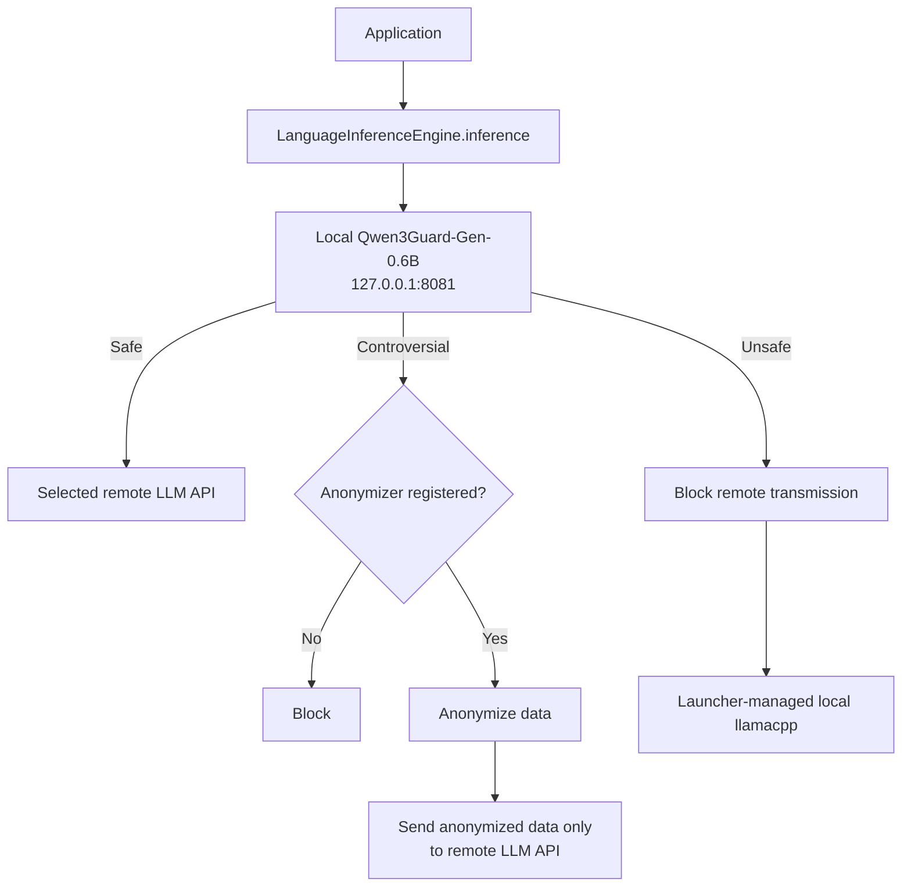
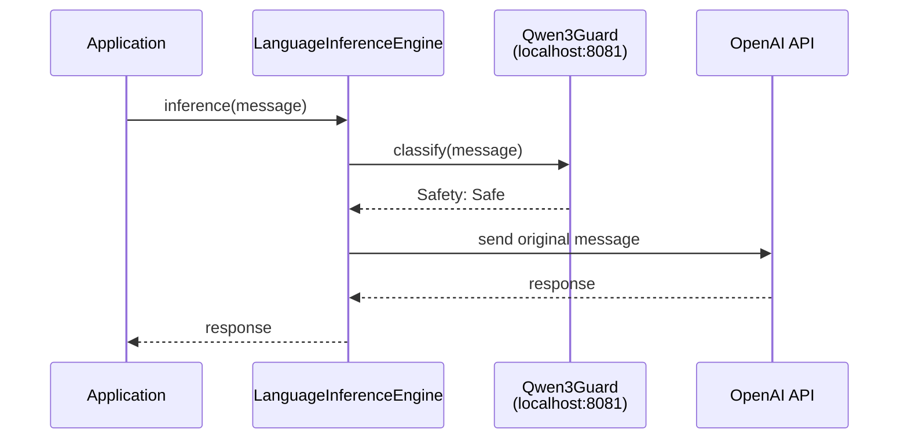
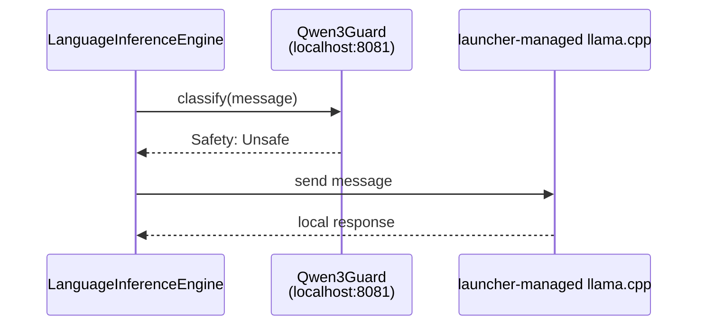

# LLM Data Flow and Qwen3Guard Policy

[한국어 문서](llm-guard-flow.md)

This document describes how WelsonJS checks LLM requests before any data is sent to an external provider.

## End-to-end flow



## Components

### 1. Request entry points

The following APIs send requests through `lib/language-inference-engine.js`:

- `LanguageInferenceEngine.inference()`
- `lib/chatgpt.js`
- `lib/anthropic.js`
- `lib/groq.js`
- `lib/grok.js`

Every request passes through the local policy check in `lib/llm-guard.js` before the provider API is called.

### 2. Qwen3Guard classification model

The Qwen3Guard-Gen-0.6B GGUF model runs locally through llama.cpp.

- Default address: `http://127.0.0.1:8081`
- API: `/v1/chat/completions`
- Model file:
  `%APPDATA%\welsonjs\qwen3guard_06b\Qwen3Guard-Gen-0.6B.Q4_K_M.gguf`
- Automatic startup: attempted when the guard server does not respond on port 8081

The classifier parses one of these labels from the model response:

```text
Safety: Safe
Safety: Controversial
Safety: Unsafe
```

If no valid `Safety` label is found, classification fails.

### 3. Remote LLM providers

Safe data is sent to the provider selected by the application. For example, an OpenAI request follows this path:



Remote providers registered in the common engine include OpenAI, Anthropic, Groq, xAI, Gemini, Mistral, and DeepSeek.

### 4. Local generation model

Unsafe data is routed to the `llamacpp` provider instead of a remote provider.

- The launcher allocates the local server port and returns it in the start response. The client uses the returned `host` and `port` for `/v1/chat/completions`.
- Default fallback model: `hy_mt2_1_8b`

The Unsafe path is therefore:



Qwen3Guard is the classification model. The launcher-managed llama.cpp server is the local response-generation model. They have different roles and may use different ports.

## Policy by classification

| Qwen3Guard label | Remote transmission | Handling |
| --- | --- | --- |
| `Safe` | Allowed | Send the original text to the selected remote LLM |
| `Controversial` | Blocked by default | Send remotely only after an anonymizer has processed it |
| `Unsafe` | Forbidden | Process only with local `llamacpp` |
| Classification failure | Forbidden | Stop the request |

`Controversial` is not treated as safe. The anonymizer is intentionally not implemented by default; an unregistered anonymizer causes the request to be blocked.

## Anonymization extension point

After implementing an application-appropriate PII anonymizer, register it as follows:

```javascript
var GUARD = require("lib/llm-guard");

GUARD.setAnonymizer(function(text, decision) {
    // Process personal data such as national IDs, phone numbers,
    // email addresses, and physical addresses.
    // Return only text that is safe to send to a remote LLM.
    return anonymizePersonalData(text);
});
```

The anonymizer must return a string. If it is missing or returns a non-string value, the remote request is stopped.

## Failure behavior

No remote LLM call is made in any of the following cases:

- The Qwen3Guard executable is missing
- The Qwen3Guard GGUF model is missing
- The local guard server is not ready
- The guard response is invalid or empty
- No `Safety` label can be parsed
- A `Controversial` request has no anonymizer
- The anonymizer does not return a string

This is a fail-closed policy: a remote request cannot proceed when the local guard is unavailable or uncertain.

## Installation and runtime requirements

Install llama.cpp and the Qwen3Guard model using these post-install component names:

```text
llamacpp
qwen3guard_06b
```

Unsafe requests require a launcher-managed local generation model. Even when a remote provider is selected, Qwen3Guard always runs locally first.

## Security scope

This policy protects the LLM provider paths registered in WelsonJS. An application can bypass it by calling an external LLM API directly through `lib/http.js` or another network client. Such code should use the shared `LanguageInferenceEngine` instead.
