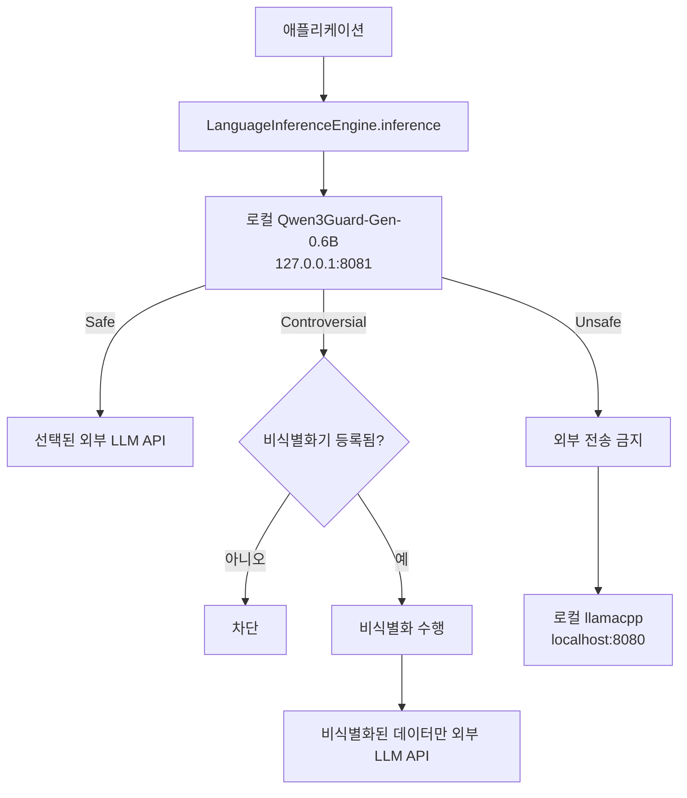
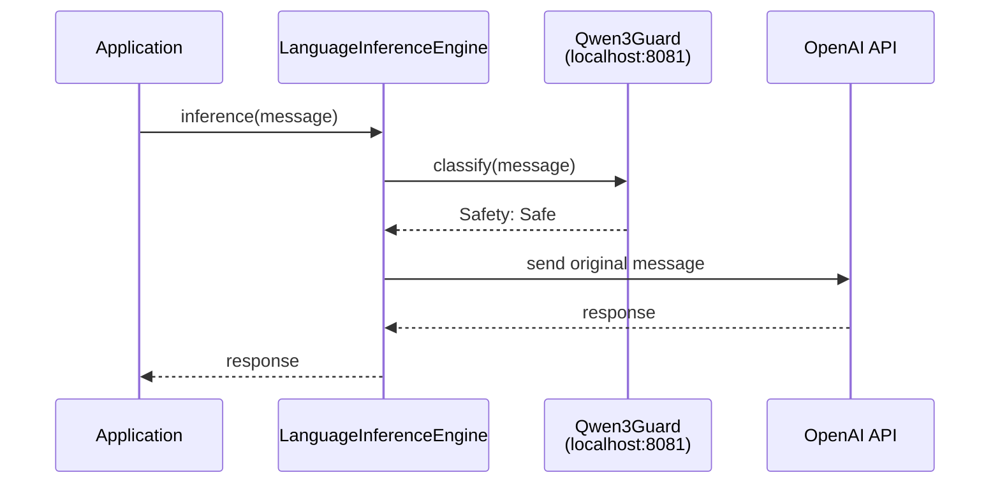
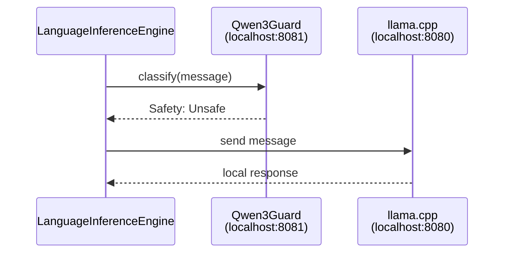

# LLM 데이터 흐름과 Qwen3Guard 정책

[English version](llm-guard-flow.en.md)

이 문서는 WelsonJS에서 LLM 요청이 외부로 전송되기 전에 어떤 검사를 거치는지 설명한다.

## 전체 흐름



## 구성 요소

### 1. 요청 진입점

다음 API들은 `lib/language-inference-engine.js`를 통해 요청을 전송한다.

- `LanguageInferenceEngine.inference()`
- `lib/chatgpt.js`
- `lib/anthropic.js`
- `lib/groq.js`
- `lib/grok.js`

각 요청은 provider의 API를 호출하기 전에 반드시 `lib/llm-guard.js`의 로컬 판정을 거친다.

### 2. Qwen3Guard 판정 모델

Qwen3Guard-Gen-0.6B GGUF 모델은 llama.cpp 서버로 실행된다.

- 기본 주소: `http://127.0.0.1:8081`
- API: `/v1/chat/completions`
- 모델 파일:
  `%APPDATA%\welsonjs\qwen3guard_06b\Qwen3Guard-Gen-0.6B.Q4_K_M.gguf`
- 자동 기동 조건: 8081의 guard 서버가 응답하지 않을 때

모델의 응답에서 다음 형식을 추출한다.

```text
Safety: Safe
Safety: Controversial
Safety: Unsafe
```

응답에 유효한 `Safety` 등급이 없으면 판정 실패로 처리한다.

### 3. 외부 LLM

Safe 데이터는 사용자가 선택한 provider로 전달된다. 예를 들어 OpenAI를 선택하면 다음 순서가 된다.



외부 provider에는 OpenAI, Anthropic, Groq, xAI, Gemini, Mistral, DeepSeek 등 공통 엔진에 등록된 provider가 포함된다.

### 4. 로컬 생성 모델

Unsafe 데이터는 외부 provider로 전달하지 않고 `llamacpp` provider로 라우팅한다.

- 기본 주소: `http://localhost:8080/v1/chat/completions`
- 기본 fallback 모델: `hy_mt2_1_8b`

따라서 Unsafe 데이터의 흐름은 다음과 같다.



Qwen3Guard는 판정 모델이고, llama.cpp의 8080 서버는 실제 응답을 생성하는 로컬 모델이다. 두 모델은 역할과 포트가 다르다.

## 등급별 정책

| Qwen3Guard 등급 | 외부 전송 | 처리 방식 |
| --- | --- | --- |
| `Safe` | 허용 | 원문을 선택된 외부 LLM에 전달 |
| `Controversial` | 기본 차단 | 등록된 비식별화기를 통과한 경우에만 외부 전송 |
| `Unsafe` | 금지 | 로컬 `llamacpp`로만 처리 |
| 판정 실패 | 금지 | 요청 전체 중단 |

`Controversial`은 안전으로 간주하지 않는다. 비식별화기는 아직 기본 구현하지 않았으며, 등록되지 않은 상태에서는 의도적으로 차단된다.

## 중립 데이터의 비식별화 확장 지점

애플리케이션이 개인정보 비식별화기를 구현한 뒤 다음과 같이 등록할 수 있다.

```javascript
var GUARD = require("lib/llm-guard");

GUARD.setAnonymizer(function(text, decision) {
    // 주민등록번호, 전화번호, 이메일, 주소 등 애플리케이션의 개인정보를 처리한다.
    // 반환값은 외부 LLM에 전송해도 되는 비식별화된 문자열이어야 한다.
    return anonymizePersonalData(text);
});
```

비식별화 함수는 반드시 문자열을 반환해야 한다. 반환값이 문자열이 아니거나 비식별화기가 등록되지 않았으면 외부 전송을 중단한다.

## 실패 시 동작

다음 상황에서는 외부 LLM 호출이 발생하지 않는다.

- Qwen3Guard 실행 파일이 없음
- Qwen3Guard GGUF 모델 파일이 없음
- 로컬 guard 서버가 준비되지 않음
- guard 응답이 JSON이 아니거나 비어 있음
- `Safety` 등급을 파싱할 수 없음
- `Controversial` 요청에 비식별화기가 없음
- 비식별화기가 문자열을 반환하지 않음

이 구조는 guard를 사용할 수 없거나 판정이 불확실한 상태에서 외부 전송이 발생하는 것을 방지하기 위한 fail-closed 정책이다.

## 설치와 실행 전제

먼저 llama.cpp와 Qwen3Guard 모델을 설치한다. post-install 구성 요소 이름은 다음과 같다.

```text
llamacpp
qwen3guard_06b
```

또한 Unsafe 요청을 로컬에서 처리하려면 8080 포트에 로컬 생성 모델을 실행할 수 있어야 한다. 외부 provider를 사용하더라도 Qwen3Guard는 항상 로컬에서 먼저 실행된다.

## 보안 범위

이 정책은 WelsonJS에 등록된 LLM provider 경로를 보호한다. 애플리케이션이 `lib/http.js`로 외부 LLM API를 직접 호출하거나 별도 네트워크 클라이언트를 사용하는 경우에는 이 게이트를 우회할 수 있으므로, 그런 코드는 공통 `LanguageInferenceEngine`을 사용하도록 작성해야 한다.
