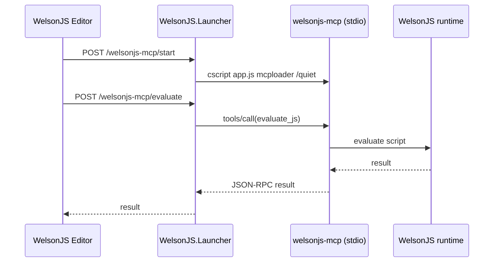

# WelsonJS Editor script execution

WelsonJS Editor runs the code in the Monaco editor through the local
`welsonjs-mcp` process. The browser UI does not execute the script itself:

The Editor ribbon provides **Run**, **Start MCP**, and **Stop MCP** actions.
`Run` starts the MCP process on demand if necessary and sends the current
editor contents to `evaluate_js` with `allowUnsafeEval: true`.

## Launcher endpoints

- `GET /welsonjs-mcp/status`
- `POST /welsonjs-mcp/start`
- `POST /welsonjs-mcp/stop`
- `POST /welsonjs-mcp/evaluate` with `{ "script": "...", "timeout": 900000 }`

The MCP process is local and is stopped when the launcher stops. Script
execution has the same host privileges and side effects as the existing
`evaluate_js` MCP tool; only use it for trusted code.
